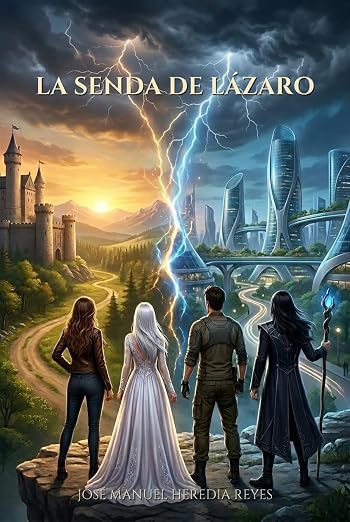
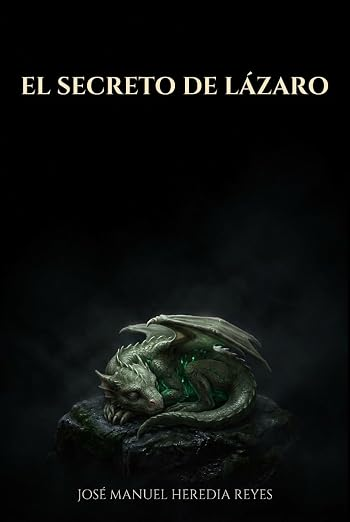
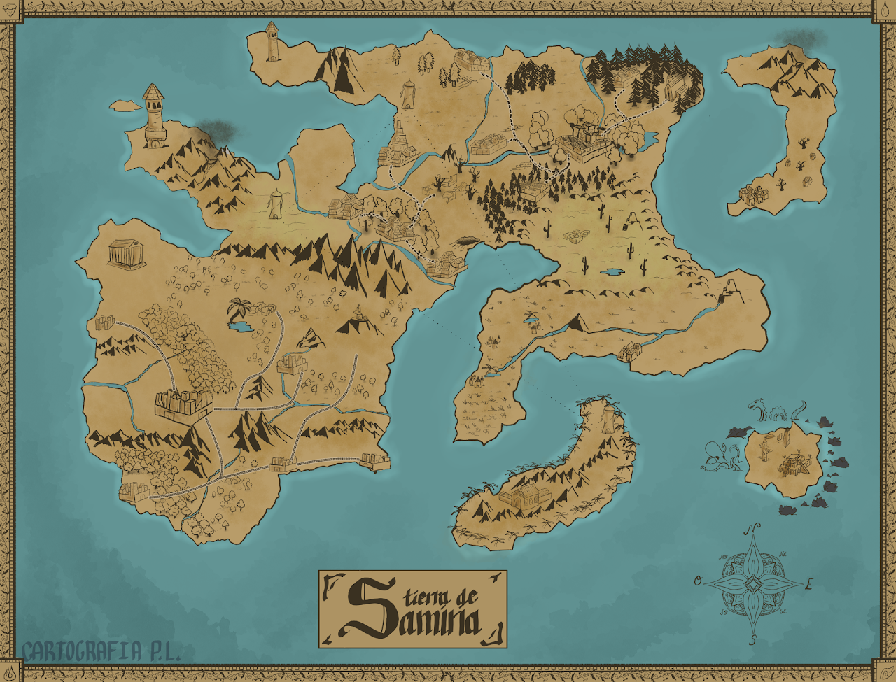

  # ✦ SAGA LÁZARO ✦
  ### *The Lazarus Saga · ラザロ・サーガ*

  **El choque de dos civilizaciones: la frontera donde la tecnología y la magia elemental colisionan.**

   

  
  
  

   

  [🌐 **Explorar Web Oficial**](https://josemhr.github.io/SagaLazaro/) • [📖 **Libros en Amazon**](#-las-novelas-publicadas) • [⏳ **Cronología**](#-cronología-histórica-4-fases) • [🗺️ **Mundo de Samiria**](#-el-mundo-de-samiria) • [👥 **Personajes**](#-protagonistas) • [✍️ **Autores**](#-los-autores)

---

> *"Dos mundos divididos por una barrera invisible. Un poder ancestral que despierta. Y cuatro destinos entrelazados en una cuenta atrás que cambiará la historia para siempre."*

---

## 📖 Las Novelas Publicadas

<table>
  <tr>
    <td align="center" width="50%" valign="top">
      
        
      <b>LIBRO I</b> 
      <b><i>La senda de Lázaro: El choque de dos mundos</i></b> 
      <i>The Path of Lazarus: The Collision of Two Worlds</i>
        
      

        La barrera entre dos realidades ha comenzado a fracturarse. Un grupo de jóvenes elegidos despierta en un continente dividido entre la supremacía tecnológica y los misterios arcanos de la magia elemental.
      

      
      &nbsp;
      
    </td>
    <td align="center" width="50%" valign="top">
      
        
      <b>LIBRO II</b> 
      <b><i>El secreto de Lázaro: El despertar de la verdad</i></b> 
      <i>The Secret of Lazarus: The Awakening of Truth</i>
        
      

        Nada es lo que parecía. La auténtica identidad tras el mito de Lázaro y el propósito oculto de las esferas salen a la luz mientras las facciones se preparan para una guerra inevitable.
      

      
      &nbsp;
      
    </td>
  </tr>
</table>

---

## ⏳ Cronología Histórica (4 Fases)

La saga se estructura en un ciclo de cuatro etapas que exploran el pasado, el presente y la resolución final del universo:

|  Fase   | Título                        |      Estado       | Enfoque Narrativo                                                                                                  |
| :-----: | :---------------------------- | :---------------: | :----------------------------------------------------------------------------------------------------------------- |
|  **I**  | **El Choque de dos Mundos**   |  🟢 **Publicado**  | *Primer libro de la saga.* Caída de la barrera y primer contacto entre tecnología y magia.                         |
| **II**  | **El Despertar de la Verdad** |  🟢 **Publicado**  | *Segundo libro de la saga.* Revelación del misterio de Lázaro y enfrentamiento contra la verdadera amenaza.        |
| **III** | **El Origen de las Esferas**  |   📜 *Precuela*    | *Orígenes y Lore.* Los acontecimientos ocurridos un siglo antes, la ambición de Aiden y la génesis de las esferas. |
| **IV**  | **El Destino Final**          | 🔮 *En Desarrollo* | *Desenlace definitivo.* La batalla final por el equilibrio de ambos mundos.                                        |

---

## 🗺️ El Mundo de Samiria

  
   
  <i>Cartografía de Samiria: División entre las Tierras Modernas, la Franja Neutral y el Reino Mágico.</i>

 

* **🏙️ Tierras Modernas (Oeste):** Civilización tecnológica regida por corporaciones y la ciencia de vanguardia.
  * *Núcleos:* **Arcanum** (capital tecnológica y sede del Enclave), **Luminar** (megaciudad vanguardista), **Avesta**, **Phelios** y **Ardenia**.
* **⚖️ Tierras Neutrales (Norte):** Territorio de tregua y comercio libre entre facciones.
  * *Núcleos:* **Halcyon** (ciudad de embajadas y acuerdos) y **Gloriam** (bastión y La Gran Torre).
* **🏰 Tierras del Reino (Este):** Tierras consagradas a los cuatro elementos y a las tradiciones arcanas.
  * *Núcleos:* **Celestia** (Corte Real elemental), **Valoria** (bastión de guardianes), **Sylphrena**, **Calendria** y la remota **Isla del Clan del Fuego**.

---

## 👥 Protagonistas

| Personaje |    Edad / Origen     | Don / Especialidad                                     | Rol en la Trama                                                                                      |
| :-------- | :------------------: | :----------------------------------------------------- | :--------------------------------------------------------------------------------------------------- |
| **Sarah** | 19 años · *Luminar*  | Dones de percepción mental e intuición anticipada      | Eje reflexivo del grupo, capaz de vislumbrar ramificaciones del destino antes de que ocurran.        |
| **Taos**  | 20 años · *Arcanum*  | Erudición arqueológica y control de la esfera temporal | Investigador del Enclave obsesionado con descifrar los vestigios antiguos y los secretos del tiempo. |
| **Yui**   | 16 años · *Celestia* | Dominio elemental del viento y agilidad aérea          | Joven prodigio de la magia elemental, hija de Helene y puente vivo entre los reinos.                 |
| **Jack**  | 24 años · *Celestia* | Esgrima de élite y táctica de combate                  | Protector leal juramentado ante la Corte Real, escudo defensivo inquebrantable del grupo.            |

> **Otras Facciones Clave:**
> * **Figuras Místicas:** *Lázaro* (figura legendaria cuyo secreto sacude ambos mundos), *Samy* y la *Pequeña Criatura*.
> * **Arcanum & El Enclave:** *Beatriz*, *Ethan*, *Kaida*, *Nero* y *Nadia*.
> * **La Corte de Celestia:** *Helene*, *Amir*, *Stefan* y *Aiden*.

---

## 🌐 Características de la Web Oficial

El portal web alojado en este repositorio ofrece una experiencia inmersiva cinematográfica:

* 🌍 **Multilingüe Reactivo (ES / EN / JP):** Cambio instantáneo de idioma sin recarga, sincronizando sinopsis, portadas de libros y enlaces regionales de compra.
* 🗺️ **Visor Cartográfico Interactivo:** Conmutación fluida entre el mapa final renderizado y el boceto original histórico de Samiria.
* ✨ **Atmósfera Cinematográfica:** Efecto de niebla de éter animado en HTML5 Canvas con partículas interconectadas.
* 🎬 **Booktrailer Cinemático Dual:** Selector y reproductor para ambas ediciones:
  * 🇪🇸 **[Booktrailer Oficial en Español (V.O.)](https://www.youtube.com/watch?v=J-JiVOMRYLo)**
  * 🇬🇧 **[Official Book Trailer in English](https://www.youtube.com/watch?v=OCZ2cjSN_Q0)**
* 🎮 **Vínculo Transmedia:** Conexión con el proyecto RPG complementario *Echoes of Truth* y el motor *Taos Game Maker*.

👉 **Visita la web en vivo:** [https://josemhr.github.io/SagaLazaro/](https://josemhr.github.io/SagaLazaro/)

---

## ✍️ Los Autores

**José Manuel Heredia Reyes** & **Elena García Sánchez**

*Creadores, escritores y desarrolladores del universo Saga Lázaro.*

[💼 Portfolio José Manuel](https://josemhr.github.io/JoseMHR/) • [🐙 GitHub de Elena](https://github.com/ElenaGSSG)

---

### 💬 Comunidad y Contacto

&nbsp;

  

---

## 🌐 Web Publicada Oficial
👉 **[https://josemhr.github.io/SagaLazaro/](https://josemhr.github.io/SagaLazaro/)**

 

© 2026 José Manuel Heredia Reyes & Elena García Sánchez. Todos los derechos reservados.

